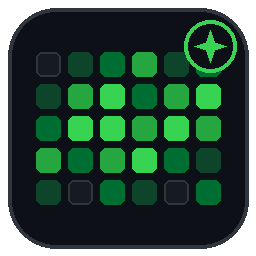

# Antigravity Token Tracker ⚡📅

[](https://www.typescriptlang.org/)
[](https://antigravity.google)
[](https://opensource.org/licenses/MIT)

> Track your Antigravity IDE token usage with a **GitHub-style calendar contribution heatmap**, daily streaks, hourly timelines, and detailed AI model analytics.



---

## ✨ Features

- 🟩 **GitHub-Style Contribution Calendar Dots**
  - Displays daily token activity on a familiar 7×52 contribution grid.
  - Dynamically calculates 5-level intensity shades based on actual token quantiles.
  - Interactive hover tooltips showing date, total tokens, input/output/thinking/cache breakdown, turns, and models used.
  - Click any date dot to open the **Day Inspector** with hourly timelines and active session lists.

- ⚡ **Real-Time Token Tracking**
  - Tracks input tokens, output tokens, thinking/reasoning tokens, and cache reads across all Antigravity IDE sessions.
  - Auto-locates the internal `language_server` process and queries session metadata via secure local RPC.
  - Multi-tiered fallback: offline persistence cache ensures instant loading with zero startup latency.

- 🔥 **Coding Streaks & Productivity KPIs**
  - **Current Streak**: Track consecutive days of AI-assisted coding.
  - **Longest Streak**: Record unbroken coding stretches.
  - **Today's Tokens**: Live tracking of today's consumption.
  - **Peak Activity Day**: Discover your most productive day.

- 🤖 **Model Analytics & Leaderboard**
  - Visual stacked breakdown of models used (Gemini 3.8 Flash, Gemini 3.1 Pro, Claude 3.7 / 4.6 Sonnet, GPT OSS, etc.).
  - Detailed table showing token counts, percentages, and turn counts per model.

- 🎨 **5 Customizable Heatmap Themes**
  - **Classic GitHub Green** (Default)
  - **Antigravity Neon Emerald**
  - **Cyberpunk Electric Cyan**
  - **Solar Flame (Orange & Amber)**
  - **Purple Nebula**
  - Seamlessly adapts to VS Code Dark and Light themes.

- ⏱️ **Status Bar Indicator**
  - Persistent status bar item: `$(flame) 2.9M today` (or total tokens / streak count).
  - Hover tooltip displays quick metrics and RPC status.
  - One-click opens the full Activity Dashboard.

- 📊 **Dual Views**
  - **Full Webview Dashboard**: Dedicated editor tab with full-width calendar, charts, and session inspector.
  - **Sidebar Activity Bar Panel**: Compact quick-glance panel accessible while coding.

- 📥 **Export to JSON & CSV**
  - One-click export of complete daily token histories and aggregates.

---

## 🚀 Quick Start

### Opening the Dashboard

1. Click the **flame/token icon** in the status bar at the bottom right.
2. Or open the Command Palette (`Ctrl+Shift+P` / `Cmd+Shift+P`) and run:
   ```
   Antigravity: Open Token Activity Dashboard
   ```
3. Or click the **Token Activity** icon in the Activity Bar on the left sidebar.

### Commands

| Command | Description |
| :--- | :--- |
| `Antigravity: Open Token Activity Dashboard` | Opens the interactive calendar and token analytics dashboard |
| `Antigravity: Refresh Token Usage Now` | Forces an immediate rescan of all sessions and updates stats |
| `Antigravity: Clear Cache and Rescan All Sessions` | Wipes the local cache and rebuilds stats from scratch |
| `Antigravity: Export Token Usage to JSON` | Exports full aggregated data and turn records to JSON |
| `Antigravity: Export Token Usage to CSV` | Exports a daily summary table to CSV |

---

## ⚙️ Configuration Settings

Customize behavior under `Settings > Extensions > Antigravity Token Activity & Calendar`:

| Setting | Default | Description |
| :--- | :--- | :--- |
| `antigravityTokenCalendar.colorTheme` | `"github-green"` | Palette for calendar dots (`github-green`, `antigravity-emerald`, `cyberpunk-cyan`, `solar-flame`, `amethyst-purple`) |
| `antigravityTokenCalendar.pollIntervalMs` | `45000` | Background poll interval in milliseconds (min `10000`) |
| `antigravityTokenCalendar.statusBarMetric` | `"today-tokens"` | Metric on status bar (`today-tokens`, `total-tokens`, `streak`) |
| `antigravityTokenCalendar.firstDayOfWeek` | `0` | Starting day of week for calendar grid (`0` = Sunday, `1` = Monday) |
| `antigravityTokenCalendar.showStatusBarItem` | `true` | Show or hide the bottom status bar item |
| `antigravityTokenCalendar.customSessionRoot` | `""` | Optional override path for Antigravity session storage |

---

## 🛠️ Development & Building

```bash
# Install dependencies
npm install

# Build extension and webview bundle
npm run build

# Watch mode for iterative development
npm run watch

# Type-check TypeScript
npm run typecheck
```

---

## 📄 License

MIT License. Designed for Google Antigravity IDE users.
